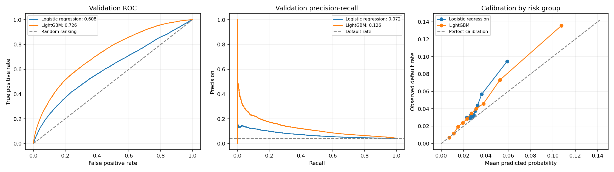

# Home Credit - Credit Risk Model Stability

Develop credit risk models that predict loan default probabilities and maintain
accurate, stable performance over time using Home Credit data.

This project explores how information available at the time of a credit
application can help estimate future default risk. It follows the
[Home Credit - Credit Risk Model Stability competition on Kaggle](https://www.kaggle.com/competitions/home-credit-credit-risk-model-stability).

## Objective

The model assigns each application a default probability between `0` and `1`.
For example, `0.07` represents an estimated 7% probability of default.

The goal is to develop models that can:

- Rank higher-risk applications above lower-risk applications.
- Produce probabilities that agree reasonably with observed default rates.
- Maintain reliable performance as application patterns change over time.

Each row in the application-level modeling table represents a credit
application. `target = 1` means default and `target = 0` means non-default.
`case_id` identifies the application; it is not necessarily a unique person.

## Current progress

The repository contains data exploration, feature-quality audits, preprocessing,
and a comparison of logistic regression with LightGBM. Both models use the same
ten numerical source features from `static_0`, joined to the base table by
`case_id`, and the same chronological training and validation cohorts.

Logistic regression establishes an interpretable benchmark. LightGBM tests
whether boosted decision trees improve predictions using those same features.
A separate NumPy implementation exposes logistic-regression training mathematics
for learning. Additional features, historical tables, and model families are
planned.

This is an active development and learning project. The locked holdout has not
been used for final evaluation, and a production scoring service is not yet
implemented.

## Dataset

Download the competition files from the
[Kaggle data page](https://www.kaggle.com/competitions/home-credit-credit-risk-model-stability/data).
The full download is approximately 26 GB; the current baseline needs only the
three training Parquet files shown below.

| Table | Role |
| --- | --- |
| `train_base.parquet` | Application IDs, decision dates, week numbers, and targets; 1,526,659 rows. |
| `train_static_0_0.parquet` and `train_static_0_1.parquet` | Two row partitions of one application-level table containing `case_id` and 167 predictors. |
| Other competition tables | Additional application and historical information for later feature engineering. |

Place the files in this structure:

```text
data/
├── feature_definitions.csv
├── sample_submission.csv
└── parquet_files/
    └── train/
        ├── train_base.parquet
        ├── train_static_0_0.parquet
        └── train_static_0_1.parquet
```

The feature dictionary and submission-format example are included in Git. Raw
datasets, dataset archives, trained model binaries, and per-application prediction
exports are excluded by [`.gitignore`](.gitignore). Download the datasets
separately; cloning this repository does not download them.

Parquet supports reading selected columns, so working with the baseline does not
require loading the complete competition dataset into memory.

## Run locally

The notebooks have been executed with Python 3.12.7. The top-level dependency
versions used for this run, including LightGBM 4.7.0, are pinned in
[`requirements.txt`](requirements.txt). Use Python 3.12 for this environment.

Clone the repository:

```shell
git clone https://github.com/JanithGayashan/home-credit-risk-model-stability.git
cd home-credit-risk-model-stability
```

Create an isolated environment and start JupyterLab. These commands are for
Windows PowerShell and do not require activating the environment:

```powershell
python -m venv .venv
.\.venv\Scripts\python.exe -m pip install --upgrade pip
.\.venv\Scripts\python.exe -m pip install -r requirements.txt
.\.venv\Scripts\python.exe -m jupyter lab
```

On macOS or Linux, use `.venv/bin/python` in place of
`.\.venv\Scripts\python.exe`.

Keep the downloaded files in the structure above. Open a notebook from the
`notebooks/` directory and run its cells from top to bottom.

**Path setup:** notebooks `01`, `02`, `02a`, and `03` retain the original absolute
Windows path. Update the `data_path` or `project_dir` variable in their setup
cells to match your checkout. The newer notebooks detect the project directory
from the repository root or its `notebooks/` directory.

## Notebook guide

For the shortest path to a working model, start with `01`, then `02`, then `05a`.
Continue with `07` to compare the logistic baseline with LightGBM. The other
notebooks provide deeper exploration, diagnostics, or mathematical explanations.
Each modeling notebook loads its own data.

| Notebook | Purpose |
| --- | --- |
| [01 - Explore base](notebooks/01_explore_base.ipynb) | Load the base table and inspect applications, targets, and time coverage. |
| [02a - Beginner static exploration](notebooks/02a_static_0_beginner_exploration.ipynb) | Understand table shape, column meanings, partitions, and join keys. |
| [02 - Build the modeling table](notebooks/02_build_first_modeling_table.ipynb) | Combine the static partitions and join selected features to the base table. |
| [03 - Static feature EDA](notebooks/03_static_0_professional_eda.ipynb) | Audit all 167 static predictors, missingness, distributions, and temporal changes. |
| [04 - Preprocess ten features](notebooks/04_preprocess_10_numeric_features.ipynb) | Learn imputation and scaling from training rows and apply them to validation rows. |
| [05a - Minimal baseline](notebooks/05a_minimal_logistic_baseline.ipynb) | Follow a compact load, split, preprocess, train, predict, and evaluate workflow. |
| [05b - Logistic regression from scratch](notebooks/05b_logistic_regression_from_scratch.ipynb) | Study sigmoid, log loss, gradients, and coefficient updates using NumPy. |
| [05 - Full baseline evaluation](notebooks/05_train_first_logistic_baseline.ipynb) | Evaluate ranking, probability quality, calibration, risk groups, and weekly stability. |
| [06 - Individual feature study](notebooks/06_study_10_features_step_by_step.ipynb) | Study features incrementally; currently includes credit-amount missingness and distribution analysis. |
| [07 - LightGBM comparison](notebooks/07_train_lightgbm_baseline.ipynb) | Refit logistic regression and train LightGBM on the same ten features; compare probabilities, calibration, and weekly stability. |

The NumPy learning notebook samples 100,000 training applications and 50,000
validation applications. Its results are separate from the full-data baseline
reported below.

## Training and evaluation

Applications are split chronologically to measure performance on later periods:

| Split | `WEEK_NUM` | Applications | Use |
| --- | --- | ---: | --- |
| Training | 0-51 | 1,065,921 | Learn preprocessing values and model parameters. |
| Development validation | 52-71 | 248,535 | Compare models and inspect probability quality and temporal stability. |
| Locked holdout | 72-91 | 212,203 | Reserved for final evaluation after development choices are frozen. |

The holdout comes from labeled training data. Kaggle's separate test files do not
contain targets and are used for competition submissions.

The logistic regression pipeline is:

```text
10 numerical features
    -> training-median imputation and missing indicators
    -> standardization using training means and standard deviations
    -> regularized logistic regression
    -> default probability
```

Five missing indicators bring the full logistic baseline to 15 prepared inputs.
The smaller NumPy training sample creates four indicators and therefore has 14.
Preprocessing is fitted on training rows and reused on later rows.

LightGBM receives the ten numerical source features directly. It uses native
`NaN` handling, preserves genuine zeros, and does not need numerical scaling for
this experiment. A fixed conservative configuration is trained with at most
1,500 trees; validation log loss selects the tree count through early stopping
with a patience of 75 rounds. No class reweighting or oversampling is applied.

`case_id`, `WEEK_NUM`, and `target` are excluded from both models' inputs. Because
the validation set also selects the LightGBM tree count, its metrics are
development estimates and must not replace the final locked-holdout evaluation.

Evaluation includes ROC AUC and Gini for ranking, average precision for the rare
default class, log loss and Brier score for probability quality, calibration
plots, and weekly performance. A constant predictor using the training default
rate provides a simple comparison.

## Development model comparison

Executed results for the same ten source features and 248,535 development
validation applications from weeks 52-71:

| Metric | Constant baseline | Logistic regression | LightGBM |
| --- | ---: | ---: | ---: |
| ROC AUC | 0.5000 | 0.6085 | 0.7262 |
| Gini | 0.0000 | 0.2169 | 0.4523 |
| Average precision | 0.0419 | 0.0723 | 0.1256 |
| Log loss, lower is better | 0.17570 | 0.17244 | 0.16031 |
| Brier score, lower is better | 0.04025 | 0.04006 | 0.03867 |

LightGBM selected 674 trees through validation-based early stopping. It improves
ranking and probability loss, with higher Gini in all 20 validation weeks.
Weekly Gini standard deviation decreased from 0.0952 to 0.0663 in this comparison.
These results support further development, rather than proving future stability.

Calibration still needs work: LightGBM's average prediction is 3.32%, compared
with the observed default rate of 4.19%; logistic regression predicts 3.17% on
average. Both models underestimate aggregate risk, and weekly calibration gaps
remain visible. No probability recalibration was fitted in this experiment.

These are development validation results, not locked-holdout results or a Kaggle
leaderboard score. Validation was also used to select the LightGBM tree count.



See the [comparison metrics](reports/baseline_10_lightgbm/performance_metrics.csv),
[weekly summary](reports/baseline_10_lightgbm/weekly_validation_summary.csv),
[run manifest](reports/baseline_10_lightgbm/run_manifest.json), and
[executed comparison notebook](notebooks/07_train_lightgbm_baseline.ipynb).
The [original logistic results](reports/baseline_10_logistic/performance_metrics.csv)
remain available for reference.

## Repository structure

```text
notebooks/        Exploration, preprocessing, modeling, and learning notebooks
reports/          Feature catalogs, summary metrics, and figures
data/             Small tracked reference files and ignored local datasets
artifacts/        Locally generated trained models, ignored by Git
requirements.txt  Pinned top-level Python dependencies
CONTRIBUTING.md   Branch, pull-request, and review workflow
```

## Next steps

- Compare broader static feature sets and engineered nonlinear features.
- Add aggregated features from historical tables.
- Compare additional model families and use more time-based development splits.
- Improve calibration and evaluate stability across additional time periods.
- Freeze the selected approach, evaluate the locked holdout, and build a
  repeatable scoring pipeline with monitoring.

## Contributing

Use a working branch and a pull request targeting `main`. Review the changes and
checks before merging. See [CONTRIBUTING.md](CONTRIBUTING.md) for the workflow.
